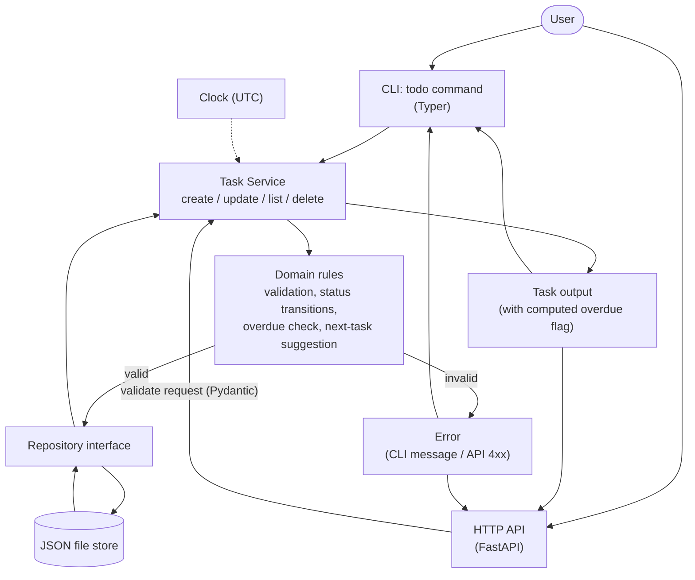
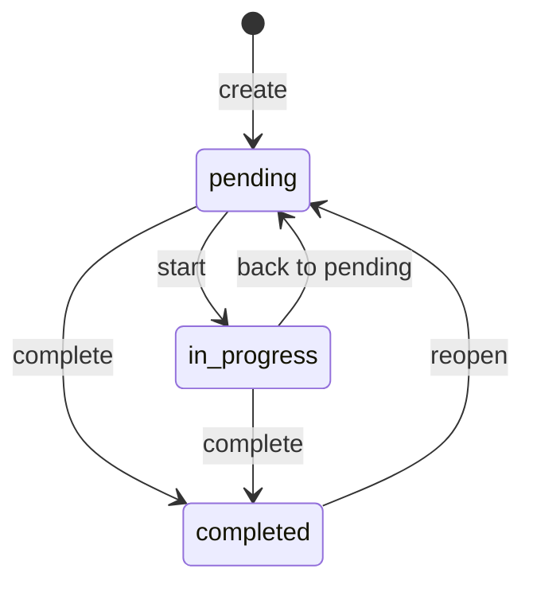
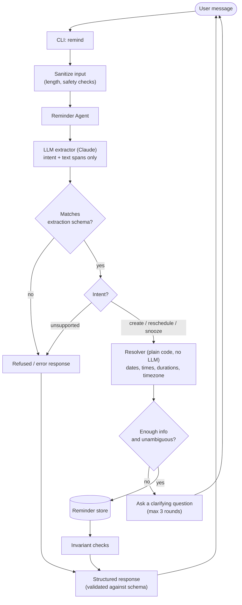
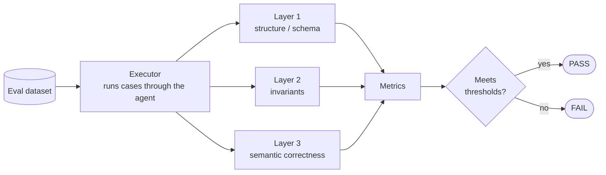
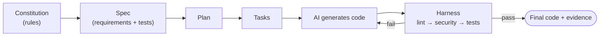

# Assignment 1 – Spec-Driven Development with AI

This repo holds two small Python projects, both built **spec-first**: we write down the rules (a "constitution" and a "spec"), let an AI generate the code, and then use automated checks (a "harness") to make sure the code actually follows those rules.

| Part | Project | One-line summary |
|---|---|---|
| [Part-1A](Part-1A) | Smart Todo & Task CLI/API | A to-do manager you can use from the terminal or over HTTP |
| [Part-1B](Part-1B) | Natural-Language Reminder Agent | Turns a sentence like *"remind me to call mom tomorrow at 5pm"* into a scheduled reminder |

---

## Part-1A – Smart Todo & Task CLI/API

A single-user task manager with two ways to use it:

- **CLI** – a `todo` command in your terminal (built with Typer)
- **API** – a JSON REST API (built with FastAPI)

Both share the same logic and the same JSON data file.

**What it can do**
- Create, read, update and delete tasks
- Filter by tag or status, sort by priority
- Move tasks between `pending` → `in_progress` → `completed` (invalid moves are rejected)
- Flag **overdue** tasks automatically
- Suggest the **next task** you should work on

**Task fields:** title, description, status, priority (low/medium/high), tags, due date, and created/updated/completed timestamps.

### Code layout (`Part-1A/src/todo`)

| Folder | Role |
|---|---|
| `domain/` | Core task rules and the "next task" logic |
| `services/` | Business operations (create, update, list…) |
| `repositories/` | Storage interface |
| `infrastructure/` | JSON file storage, clock, serialization |
| `interfaces/cli`, `interfaces/api` | The terminal and HTTP front-ends |
| `app/` | Config and wiring everything together |

### Flow diagram



**Task status flow**



### Run it

```bash
cd Part-1A
pip install -e ".[dev]"
todo --help                 # CLI
python -m todo.interfaces.api   # start the API
pytest                      # run tests
```

### Run the harness (Part-1A)

The harness runs lint, then security checks, then tests, and ends with an overall PASS/FAIL (exit code 0 = PASS). Every run is appended to `Part-1A/.harness/harness-log.md`.

```bash
cd Part-1A
pip install -e ".[dev]"
python .harness/run_harness.py              # all checks
python .harness/run_harness.py --skip-audit # offline: skip pip-audit
python .harness/run_harness.py --only tests # lint | security | tests
```

---

## Part-1B – Natural-Language Reminder Agent

An agent that reads an English message and creates a structured reminder. It can also **reschedule** or **snooze** an existing one. If something is missing or unclear (e.g. no time given), it **asks a question instead of guessing**.

**Key ideas**
- The LLM (Claude) only *extracts* what the user meant – it never calculates dates.
- Plain, deterministic code resolves dates/times using the configured timezone.
- Output must match JSON schemas, and safety rules reject unsupported requests.
- Quality is measured on an evaluation dataset against set thresholds.

### Flow diagram



**How quality is checked**



### Run it

```bash
cd Part-1B
pip install -e ".[dev]"
remind --help
pytest
python evals/run_eval.py    # deterministic evaluation (replay)
```

### Run the harness (Part-1B)

Part-1B has **two evaluation pipelines**. Both append to `Part-1B/evidence/harness-log.md`.

```bash
cd Part-1B
pip install -e ".[dev]"

# 1. Deterministic pipeline: replays recorded extractions, no network, no API key. Exit code 0 = PASS.
python evals/run_eval.py --label "my run"

# 2. Non-deterministic pipeline: the real Claude model extracts, each case is repeated.
export GROQ_API_KEY=...             # or put it in a git-ignored .env file; never commit it (PowerShell: $env:GROQ_API_KEY="...")
python evals/run_live_eval.py --runs 3 --pause 1          # Groq (default provider)
python evals/run_live_eval.py --provider anthropic        # needs ANTHROPIC_API_KEY instead
python evals/run_live_eval.py --stub-client   # offline smoke test of the pipeline, not real model evidence

# Record the final human decision
python .harness/log.py decision --decision ACCEPT --by "<your name>" --notes "<why>"
```

### Acceptance and known limitations

See [Part-1A/ACCEPTANCE.md](Part-1A/ACCEPTANCE.md) and [Part-1B/ACCEPTANCE.md](Part-1B/ACCEPTANCE.md).

---

## Overall workflow (both parts)



## What's in each part

```
Part-X/
├── .speckit/   Constitution, spec, plan, tasks (the "rules" written before coding)
├── .harness/   Automated checks: lint, security, tests, and quality gates
├── src/        Final source code
├── tests/      Test suite
└── evidence/   Snapshot of the first AI-generated code (with SHA-256 hash) for comparison
```

Part-1B additionally has `evals/` with the evaluation dataset and runner.

## Requirements

- Python 3.11+
- Part-1B's live evaluation needs a `GROQ_API_KEY` (or `ANTHROPIC_API_KEY`) environment variable or git-ignored `.env`. No keys or `.env` files are stored in this repo.
